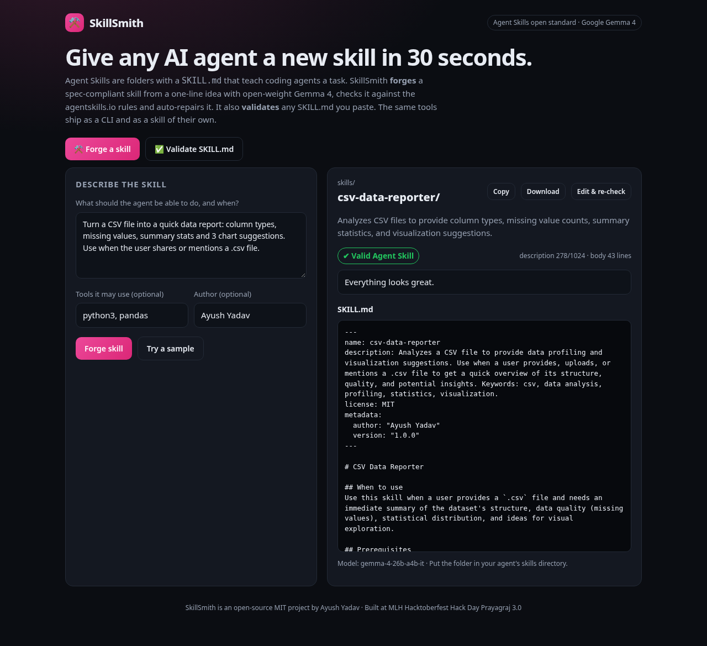
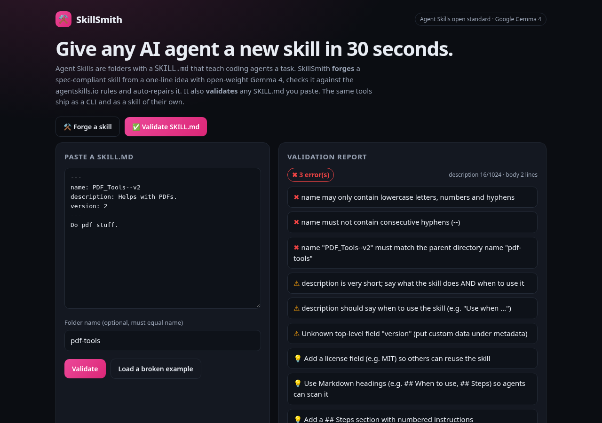

# ⚒️ SkillSmith

**Give any AI agent a new skill in 30 seconds.** [Agent Skills](https://agentskills.io) are folders with a `SKILL.md` that teach coding agents a task. SkillSmith does two things:
- **Forge:** it turns a one-line idea into a spec-compliant skill with **Google Gemma 4** (an open-weight model). It validates the result and auto-repairs it if needed.
- **Validate:** it lints any `SKILL.md` against the open standard.

It comes as a web app, a zero-dependency CLI, and an Agent Skill of its own.




## Why
Agent Skills are a new open standard, and most hand-written skills break the rules: uppercase names, a folder name that doesn't match, vague descriptions with no "Use when…", or secrets pasted inline. Agents then never load the skill. SkillSmith makes writing a correct skill trivial and gives skill authors a CI-friendly linter (exit code 1 on errors).

## Prize track
**Best Open-Source AI Project** (Hacktoberfest 2026 × MLH).
- Open-weight Gemma 4 is the core of the generator.
- The repo is public and MIT licensed.
- The bundled `skills/skillsmith/SKILL.md` complies with the Agent Skill Open Standard; SkillSmith validates itself.

It also fits **Best Use of Gemma 4**.

## What the validator checks
These rules come from the [agentskills.io specification](https://agentskills.io/specification):
- **`name`**: required, 1-64 characters, only `a-z 0-9 -`, no leading or trailing hyphen, no `--`, and it must match the folder name.
- **`description`**: required, 1-1024 characters. It warns if the text is very short or has no "Use when…".
- **`compatibility`**: 500 characters or fewer if present. **`license`** must be a string. **`metadata`** must be a string map. **`allowed-tools`** must be a string.
- **Unknown top-level fields** get a warning.
- **The body**: it warns if the body is empty or longer than 500 lines, and gives tips on headings and Steps.
- **Secrets**: an API key or token pattern found anywhere in the file is an error.

## CLI
```bash
git clone https://github.com/ayush8620/skillsmith && cd skillsmith
node cli.js validate skills/skillsmith path/to/other-skill        # offline, no key needed
export GEMINI_API_KEY=your_key                                    # free: https://aistudio.google.com/apikey
node cli.js new "Write release notes from git commits since the last tag. Use when the user asks for a changelog." --out ./skills --author "Your Name"
```
`new` never overwrites an existing `SKILL.md` and never writes outside the new skill folder.

## Web app
```bash
cp .env.example .env && export GEMINI_API_KEY=your_key
node server.js     # http://localhost:3000 (Node 18+, no npm install)
```
API:
- `POST /api/forge {"idea","tools?","author?"}`
- `POST /api/validate {"skillMd","dirName?"}` (no AI)

## Deploy (free)
Import the repo on [Vercel](https://vercel.com/new) (preset "Other"), set `GEMINI_API_KEY`, and deploy.

## Tech
- Vanilla JS and Node 18+ with zero npm dependencies, including a tiny YAML frontmatter parser.
- **Google Gemma 4** (`gemma-4-31b-it` and `gemma-4-26b-a4b-it` in parallel with retries) via the Gemini API.

| Path | What |
|---|---|
| `lib/validate.js` | spec validator + frontmatter parser |
| `lib/forge.js` | Gemma 4 generator with validate-and-repair loop |
| `cli.js` | `skillsmith validate` / `skillsmith new` |
| `skills/skillsmith/SKILL.md` | SkillSmith as an Agent Skill |
| `api/forge.js`, `api/validate.js`, `api/_gemma.js` | web API |
| `index.html`, `style.css`, `app.js` | UI |
| `server.js` | local dev server |

## License
[MIT](LICENSE) © 2026 Ayush Yadav. Built at MLH Hacktoberfest Hack Day Prayagraj × WikiClub Tech UIT (Edition 3.0).
